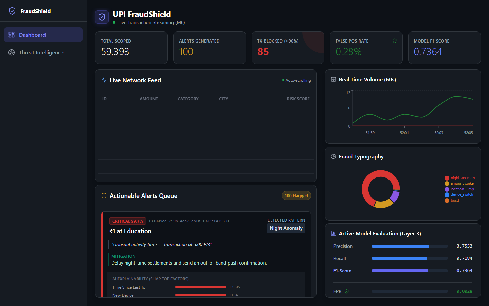
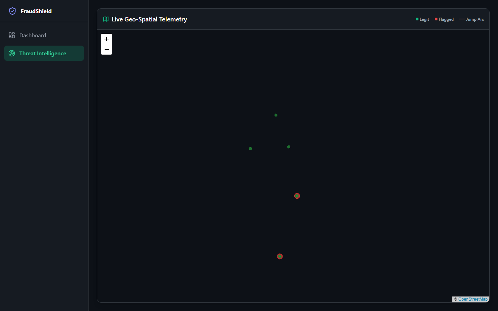
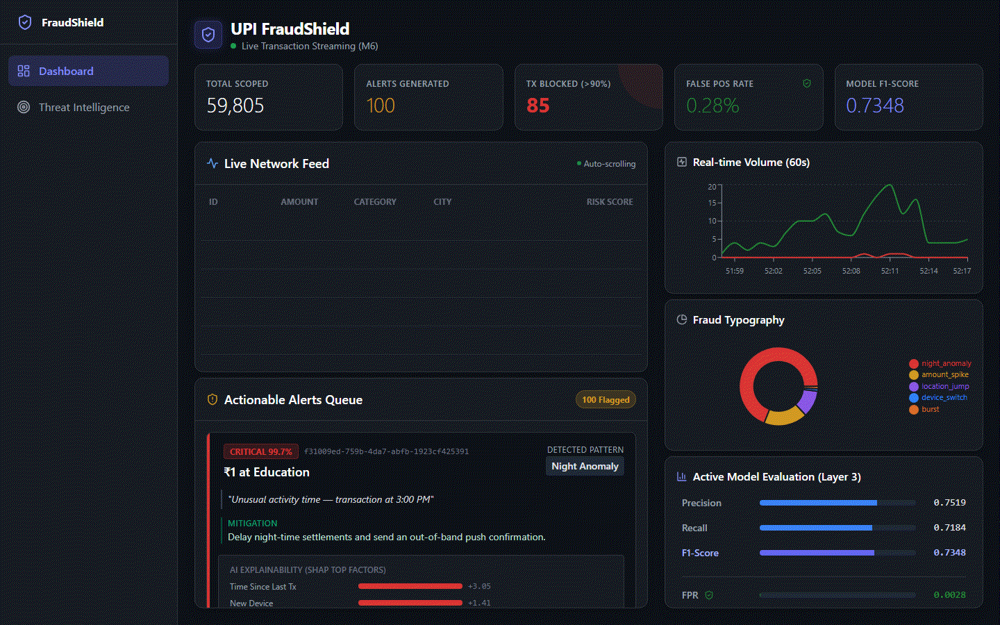

# UPI FraudShield

An end-to-end fraud detection demo for Unified Payments Interface (UPI) traffic: FastAPI + WebSockets backend, XGBoost + SHAP, and a React dashboard with a live feed and India GeoMap.







---

## Key Features

### AI & Machine Learning
- **Synthesizer:** Synthetic Indian UPI traffic with configurable fraud rate and hard negatives (`generate_dataset.py`).
- **XGBoost:** Supervised classifier on 32 engineered features with a leak-free per-user time split.
- **SHAP:** Top-3 feature explanations and mitigation text for flagged transactions.

### Real-Time Backend
- **FastAPI & WebSockets:** Live CSV replay stream with batch scoring and a monotonic-clock scheduler.
- **REST Telemetry:** `/score`, `/alerts`, `/metrics`, `/profile/{user_id}` plus WS `/stream`.

### SOC Dashboard
- **Live Network Feed** with risk scores.
- **Actionable Alerts** with SHAP bars and mitigation recommendations.
- **Geo-Spatial Telemetry:** Leaflet + OpenStreetMap (CSS dark filter) with location-jump arcs between cities.

---

## Results (measured)

### Synthetic UPI test set (`models/xgb_metrics.json`)

| Metric | Value |
|---|---:|
| Decision threshold | 0.794784 |
| ROC-AUC | 0.8901 |
| PR-AUC | 0.5572 |
| Precision | 0.4993 |
| Recall | 0.5434 |
| F1 | 0.5204 |

### Stream throughput (`scripts/measure_throughput.py`, n=500, warmup=20)

| Requested tps | Achieved msg/s |
|---:|---:|
| 10 | 10.02 |
| 20 | 20.04 |
| 50 | 50.25 |
| 100 | 100.26 |

### Validation on a real-world dataset (separate from UPI)

**Dataset:** ULB Credit Card Fraud (`creditcard.csv`)  
**Split:** time-ordered by `Time` — 70% train / 15% val / 15% test  
**Note:** This benchmark does **not** use the UPI synthetic data or replace the UPI models. Full write-up: [`benchmarks/RESULTS.md`](benchmarks/RESULTS.md).

| Metric (test) | Value |
|---|---:|
| ROC-AUC | 0.9823 |
| PR-AUC | 0.7647 |
| Precision | 0.4699 |
| Recall | 0.7500 |
| F1 | 0.5778 |

Fraud rates measured: train **0.1926%**, val **0.1311%**, test **0.1217%**. Threshold **0.148434** (val: max recall s.t. precision ≥ 0.5).

---

## Limitations

- UPI dashboard metrics are on **synthetic** data made harder with hard negatives, overlapping fraud patterns (~70% signature strength), ~0.8% fraud rate, and **1% train-only label noise**.
- Precision / recall depend on the validation-chosen threshold; they are not fixed product KPIs.
- Stream throughput was measured on **one Windows machine**; other hardware will differ.
- Users/merchants are shared across the time split; real unseen-entity performance will be lower.
- The ULB benchmark is a **separate** credit-card experiment, not a claim about production UPI.

---

## Architecture

**Backend:** Python 3.10+, FastAPI, Uvicorn, scikit-learn, XGBoost, SHAP  
**Frontend:** React 18, TypeScript, Vite, TailwindCSS, Recharts, Leaflet, React-Leaflet

```text
upi_fraud_detector/
├── api/                  # FastAPI + WebSocket stream
├── dashboard/            # React Vite app
├── explainability/       # SHAP + NL explanations
├── models/               # Trained XGBoost artifacts (committed)
├── benchmarks/           # Separate real-data benchmark scripts/results
├── generate_dataset.py
├── train_models.py
├── requirements.txt
└── upi_transactions.csv  # generated locally (gitignored)
```

---

## Quick start (clean clone)

```bash
git clone https://github.com/saivignesh060/upi_fraud_shield.git
cd upi_fraud_shield

python -m venv .venv
# Windows PowerShell:
.\.venv\Scripts\Activate.ps1
# Linux/macOS:
# source .venv/bin/activate

pip install -r requirements.txt
python generate_dataset.py          # writes upi_transactions.csv (~0.8% fraud; can take several minutes)
# Optional retrain (pretrained models are already in models/):
# python train_models.py

python -m uvicorn api.main:app --host 0.0.0.0 --port 8000
```

Keep the venv activated for all Python commands (system site-packages can break SHAP pickle loads).

In a second terminal:

```bash
cd dashboard
npm install
npm run dev
```

Open `http://localhost:5173`. API: `http://localhost:8000`.

### Real-data benchmark (optional)

```bash
# Place ULB file at benchmarks/creditcard.csv
# (Kaggle: https://www.kaggle.com/datasets/mlg-ulb/creditcardfraud)
python benchmarks/real_data_benchmark.py --dataset ulb
```

### Throughput measurement

```bash
# with API running on :8000
python scripts/measure_throughput.py --n 500 --warmup 20 --tps 10 20 50 100
```

---

## Navigating the Platform

1. **Main Dashboard:** Real-time volume chart, model evaluation (F1/FPR), actionable alerts with SHAP + mitigation.
2. **Threat Intelligence:** India GeoMap with location-jump arcs.

---

## Production Deployment

### Backend (Render / Railway / EC2)
- Build: `pip install -r requirements.txt`
- Start: `uvicorn api.main:app --host 0.0.0.0 --port $PORT`
- Generate `upi_transactions.csv` on the server (`python generate_dataset.py`). Models in `models/` are already in the repo.

### Frontend (Vercel)
- Root directory: `dashboard`
- Env: `VITE_API_URL=https://your-backend-url`
- `App.tsx` already maps `https`→`wss` / `http`→`ws`.

---

## License
Developed for demonstration and operational prototyping.
